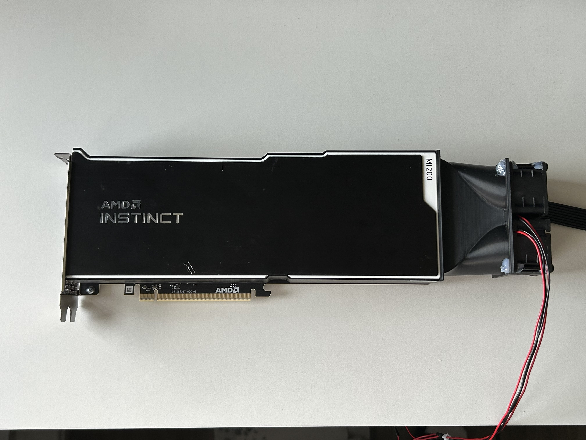
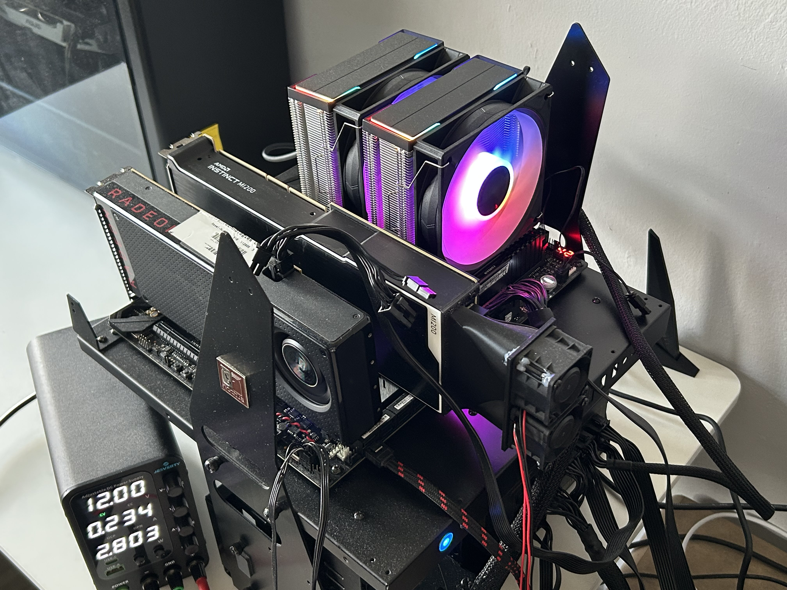
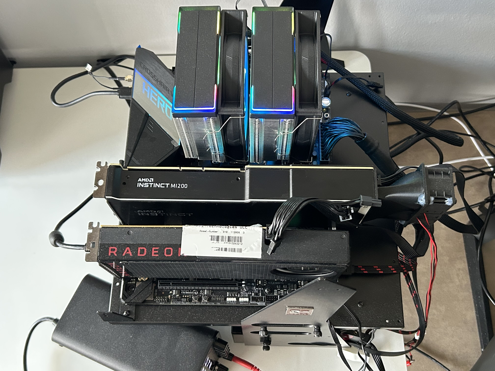

# ROCm-Passthrough-K3s

[](https://github.com/xuej41/rocm-passthrough-k3s/actions/workflows/ci.yml)

Using my AMD Instinct MI210 (PCIe) passed through with VFIO to a KVM guest running ROCm, scheduled by k3s with AMD's device plugin. Also includes `passthrough-check`, a small tested tool that checks a GPU's passthrough readiness from sysfs.

```
Host (Ubuntu, amdgpu drives the RX 480 display)
 └─ vfio-pci ── MI210
     └─ KVM / QEMU q35 + OVMF (UEFI)
         └─ Ubuntu 22.04 guest ── ROCm
             ├─ k3s ── ROCm device plugin (amd.com/gpu)
             │   └─ pod: rocm-smi
             └─ AMD metrics exporter ── Prometheus ── Grafana
```

## Hardware

| Part | Model |
|---|---|
| GPU (compute) | AMD Instinct MI210 64 GB HBM2e with custom cooling shroud |
| GPU (host) | AMD Radeon RX 480 8 GB |
| CPU | AMD Ryzen 7 5800XT 8 core 16 thread CPU |
| Motherboard | ASUS ROG X570 Crosshair VIII Hero Wi-Fi|
| Memory | 32 GB (4 × 8 GB) Corsair Vengeance DDR4-3200 CL16 |
| Storage | Samsung 980 PRO |
| Power supply | Seasonic Prime Gold 1200 W |
| Chassis | Lian Li open-air test bench |

Host OS: Ubuntu 26.04 LTS, kernel 7.0.

<p align="center">
  
  <br>
  <sub>The MI210 is passively cooled, so a 3D-printed shroud with two fans pushes air through its heatsink.</sub>
</p>
<p align="center">
  
  
  <br>
  <sub>The bench, and a top-down view: MI210 in the top slot, RX 480 below.</sub>
</p>

## Status

| Component | Status |
|---|---|
| Host: IOMMU, KVM, libvirt, OVMF | Planned |
| MI210 passthrough VM with ROCm, benchmarked against bare metal | Planned |
| k3s pod using `amd.com/gpu: 1` | Planned |
| `passthrough-check` tool, tests, CI | In progress |
| GPU monitoring: AMD exporter, Prometheus, Grafana | In progress |
| Docker GPU access (`/dev/kfd`, `/dev/dri`) | Done |
| NVIDIA path (RTX 4060 Ti) | Planned |

Errors and fixes: [LOG.md](LOG.md).

## Results

Bare metal vs guest: see [bench/results/comparison.md](bench/results/comparison.md) (not run yet). [`bench/`](bench/README.md) runs the same GEMM and copy-bandwidth tests on both sides, and `bench/plot.py` turns the results into a table and chart.

Live GPU metrics: [`monitoring/`](monitoring/README.md) sets up AMD's Device Metrics Exporter, Prometheus and a Grafana dashboard, on k3s or with Docker Compose.

<!-- Screenshots: put them in docs/img/, then uncomment.
<p align="center">
  
</p>
<p align="center">
  
</p>
<p align="center">
  
</p>
-->

## passthrough-check

Reads sysfs and reports, for each GPU:

- the bound **driver** (`amdgpu`, `vfio-pci`, …)
- its **IOMMU group** and the other devices in it (bridges and sibling functions are allowed)
- **PCIe link speed and width** compared with the maximum
- the **reset method**, which tells you whether the card can recover after the VM stops

```bash
pip install -e '.[dev]'
passthrough-check                                  # auto-detect AMD/NVIDIA GPUs
passthrough-check 0c:00.0 --expect-driver vfio-pci # while the VM runs
passthrough-check 0c:00.0 --expect-driver amdgpu   # after the VM stops
passthrough-check --json
```

Exit codes: `0` ready, `1` problems found, `2` device not found or bad input.

Development: `pytest`, then `ruff check . && ruff format --check .`. The tests build a fake sysfs tree, so they run anywhere, including CI.

## Repo layout

| Path | Purpose |
|---|---|
| `host/` | Host checks, IOMMU group listing, vfio-pci fallback config |
| `vm/` | VM creation and libvirt XML snippets |
| `k8s/` | GPU pod manifests (AMD, and optional NVIDIA) |
| `bench/` | Benchmark, results, and chart generator |
| `monitoring/` | Prometheus + Grafana + AMD exporter (k3s or Docker Compose), MI210 dashboard |
| `src/`, `tests/` | `passthrough-check` and its tests |
| `docs/` | Troubleshooting, AMD vs NVIDIA comparison, roadmap |

## Scope

- Passthrough, the k3s GPU pod, Docker GPU access, GPU monitoring.
- Future: see [docs/roadmap.md](docs/roadmap.md) (KubeVirt, SR-IOV/GIM, vLLM, packaging).